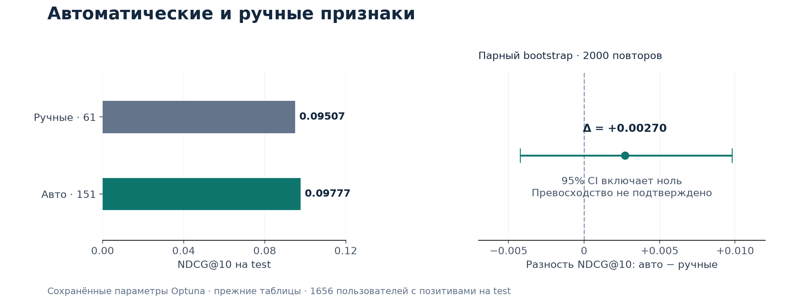

# Автоматическая генерация признаков для рекомендаций

**Учебный исследовательский проект на Yambda-50M**

Цель проекта — изучить автоматизацию feature engineering в рекомендательных системах и проверить её на эксперименте. Я исследую, насколько автоматическая генерация признаков может заменить ручной выбор временных окон в рекомендательной модели. Я реализовал генератор агрегатов, сравнил его с ручными наборами на LightGBM и оценил устойчивость различий с помощью парного bootstrap по пользователям.

**Python · pandas · NumPy · LightGBM · Optuna · scikit-learn · PyArrow**

[Методология](docs/methodology.md) · [Результаты](docs/results.md) · [Воспроизведение](docs/reproduction.md) · [Ноутбук](notebooks/T-Lab.ipynb) · [PDF-отчёт](reports/final_report.pdf)

## Задача

В табличных рекомендательных моделях признаки часто создаются вручную: например, число прослушиваний артиста за 7 дней или доля лайков за месяц. Такой подход ограничивает исследование окнами, которые заранее выбрал разработчик.

Я проверил альтернативу: описать признаки шаблоном **«сущность × событие × временное окно»**, автоматически собрать комбинации и сравнить качество ранжирования с ручным набором.

Эксперимент использует открытые [данные Yambda](https://huggingface.co/datasets/yandex/yambda). Строка — прослушивание, целевое событие — первый лайк пары «пользователь — трек» в течение следующего часа. Задача — упорядочить наблюдённые прослушивания пользователя по вероятности лайка.

## Выполненная работа

- **Подготовку данных:** подвыборка 5000 пользователей со всей историей, разметка событий, временные срезы и фильтр ранее лайкнутых пар.
- **Признаки:** ручные наборы из 37 и 61 признака; автоматический набор из 151 признака, включая окна до 180 дней и всю историю.
- **Эксперименты:** классификация LightGBM, исторические сравнения с LambdaRank, отбор top-37 и отсев коррелирующих признаков.
- **Оценку:** пользовательские NDCG@10 и Recall@10, парный bootstrap, раздельное хранение точечной разности и доверительного интервала.
- **Воспроизводимость:** последовательный ноутбук, сохранённые параметры и версии, контрольные суммы входных таблиц, тесты метрик и временных границ.
- **Протокол Optuna:** одинаковое пространство и бюджет для двух наборов, выбор по val, сохранение истории в SQLite и CSV. Полный новый поиск ещё не выполнен.

## Подход

```text
Прослушивания и лайки Yambda
             │
Подвыборка пользователей → метки → временные срезы
             │
    ┌────────┴─────────┐
Ручные агрегаты    Генератор комбинаций
 37 / 61 признак      151 признак
    └────────┬─────────┘
          LightGBM
             │
Выбор настроек по val → оценка на test
             │
 NDCG@10 · Recall@10 · парный bootstrap
```

Генератор работает с пользователем, треком, парой пользователь–трек, пользователь–артист и пользователь–альбом. Он рассчитывает счётчики событий, конверсии и среднюю долю прослушивания. История агрегатов ограничена событиями до среза.

## Основной результат

В контрольном запуске на сохранённых таблицах я повторно обучил четыре классификатора. Таблица ниже показывает модели с параметрами, сохранёнными после исторического поиска Optuna.

| Набор | Признаков | NDCG@10 val | NDCG@10 test | Recall@10 test |
|---|---:|---:|---:|---:|
| Ручной + артист/альбом | 61 | **0,09411** | 0,09507 | **0,12575** |
| Автоматический | 151 | 0,08973 | **0,09777** | 0,12391 |

**Разность NDCG@10 на test: +0,00270, или +2,84% относительно ручной модели.** 95% bootstrap-интервал: **[−0,00424; +0,00980]**. Интервал включает ноль, поэтому статистически подтверждённого превосходства нет. По Recall@10 автоматическая модель уступает ручной.



Ручной вариант для сравнения выбран по val. Метрики усредняются по пользователям с положительными событиями: на test их 1656 из 4941 пользователя после фильтров. Исходная подвыборка содержит 5000 пользователей.

**Статус результатов:** это исследовательский запуск на таблицах прежнего временного протокола. Я выявил необходимость часового зазора на горизонт метки и реализовал его в пересборке данных; полный прогон на пересобранных таблицах ещё предстоит. [Все результаты и ограничения →](docs/results.md)

## Выводы

1. Шаблонная генерация даёт работоспособный набор признаков и позволяет систематически исследовать временные окна.
2. Большее число признаков не гарантирует улучшения: отбор top-37 и удаление корреляций тоже не дали однозначного выигрыша в исторических экспериментах.
3. Точечное улучшение метрики требует статистической проверки. Текущие данные не позволяют утверждать ни превосходство, ни эквивалентность моделей.
4. Проверка временных границ метки столь же важна, как ограничение истории признаков: для часовой метки нужен полный час наблюдений после кандидата.

## Быстрый старт

```bash
git clone https://github.com/w4ngle/recsys-auto-features.git
cd recsys-auto-features
python -m venv .venv
source .venv/bin/activate
pip install -r requirements.txt
python -m unittest discover -s tests
```

Тесты работают на небольших синтетических примерах и не скачивают Yambda. Для macOS при ошибке загрузки OpenMP может потребоваться `brew install libomp`.

**Посмотреть исследование без загрузки данных:** открыть [выполненный ноутбук](notebooks/T-Lab.ipynb), [таблицу результатов](reports/recheck/results_recheck.csv) или [PDF](reports/final_report.pdf).

**Запустить эксперимент:** подготовить шесть parquet-таблиц или пересобрать их через `prepare_data.py`, затем выполнить ноутбук. Данные не включены в Git. Подробные команды, выбор режима и требования к окружению — в [инструкции воспроизведения](docs/reproduction.md).

## Структура проекта

```text
src/                 загрузка, признаки, LightGBM, метрики, Optuna
prepare_data.py      пересборка таблиц с зазором на горизонт метки
notebooks/          выполненный эксперимент и архив исследований
tests/              проверки метрик, признаков и временных границ
docs/               методология, результаты, воспроизведение
reports/recheck/     CSV, bootstrap, параметры, важности, метаданные
reports/historical/ артефакты ранних экспериментов
```

## Ограничения и дальнейшая работа

Кандидаты — наблюдённые прослушивания, а не весь каталог; повторные события не дедуплицируются. Эксперименты проведены на одной подвыборке пользователей, test использовался в ходе исследования. Полный журнал исторического Optuna-поиска не сохранён.

Следующие шаги: пересобрать данные с часовыми зазорами и проверить полноту лайков; выполнить новый одинаковый поиск для обоих наборов; оценить устойчивость на нескольких seed и новом временном периоде. Область применимости и технические детали описаны в [методологии](docs/methodology.md).

**Автор:** [Артур / w4ngle](https://github.com/w4ngle). Учебный проект по рекомендательным системам, feature engineering и оценке ML-экспериментов.
